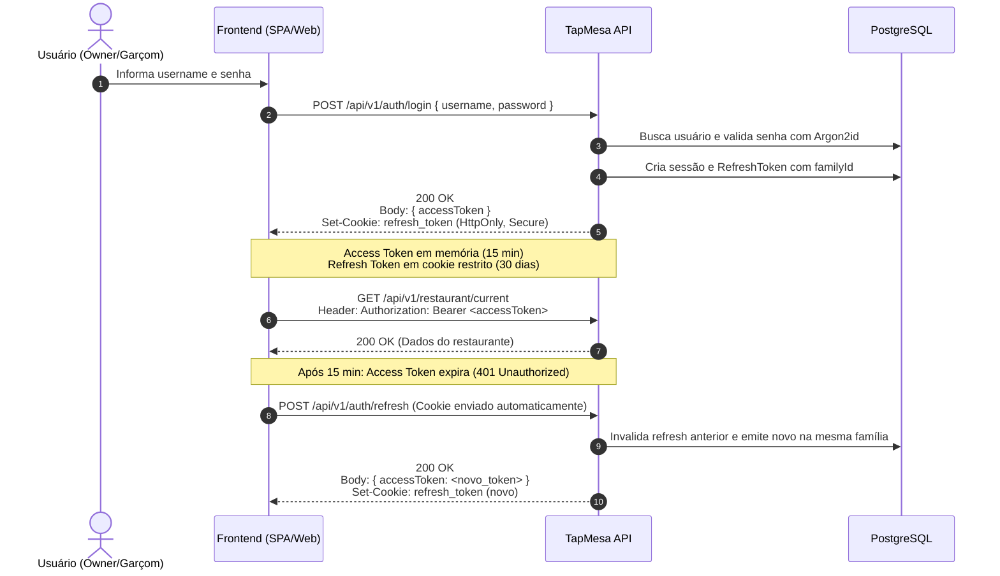

# Autenticação, Permissões e Multi-Tenancy — TapMesa Backend

Este documento estabelece o modelo oficial de segurança, identidade, controle de acesso e isolamento de dados entre restaurantes da API TapMesa.

---

## 1. Visão Geral da Arquitetura de Autenticação

A segurança do TapMesa é baseada no padrão **Dual Token (Access Token de curta duração + Refresh Token rotativo de longa duração com proteção contra reúso)**.



---

## 2. Tokens de Acesso (JWT Access Token)

### 2.1. Estrutura do Token

O `accessToken` é um JSON Web Token assinado com algoritmo **HMAC SHA-256** (HS256).

- **Tempo de Vida (TTL):** 15 minutos (900 segundos).
- **Envio pelo Frontend:** Deve ser enviado no cabeçalho HTTP:
  ```http
  Authorization: Bearer <accessToken>
  ```
- **Formato das Claims decodificadas:**
  ```json
  {
    "sub": "e2293b22-c32f-4889-a5e0-f38b02daeeaa",
    "username": "carlos_gerente",
    "role": "OWNER",
    "rid": "58ef7166-7245-42a1-b65f-40e895c1c8ba",
    "restaurantId": "58ef7166-7245-42a1-b65f-40e895c1c8ba",
    "imp": null,
    "iat": 1729440000,
    "exp": 1729440900
  }
  ```

| Claim                  | Tipo                      | Descrição                                                                                                         |
| :--------------------- | :------------------------ | :---------------------------------------------------------------------------------------------------------------- |
| `sub`                  | `string` (UUID)           | ID único do usuário (`User.id`).                                                                                  |
| `username`             | `string`                  | Nome de usuário único no sistema.                                                                                 |
| `role`                 | `enum`                    | Perfil de permissão: `ADMIN`, `OWNER` ou `WAITER`.                                                                |
| `rid` / `restaurantId` | `string` (UUID) \| `null` | ID do restaurante do usuário. Nulo para `ADMIN`.                                                                  |
| `imp`                  | `string` (UUID) \| `null` | Presente se for uma sessão de **impersonação** por um administrador. Contém o `userId` do administrador original. |
| `iat` / `exp`          | `number`                  | Timestamps Unix de emissão e expiração.                                                                           |

### 2.2. Rotação de Chaves de Assinatura (Key Rotation)

O backend possui suporte a rotação de segredos sem desconectar usuários ativos (implementado em [`JwtAuthGuard`](../../src/modules/identity-access/presentation/guards/JwtAuthGuard.ts)). Se uma chave anterior estiver configurada em `JWT_PREVIOUS_ACCESS_SECRET` e `JWT_PREVIOUS_KEY_ID`, tokens emitidos com a chave anterior continuam válidos até expirarem naturalmente.

---

## 3. Rotação de Refresh Token & Detecção de Reúso

### 3.1. Armazenamento Seguro em Cookie HttpOnly

O `refresh_token` **nunca** é exposto ao JavaScript do cliente. Ele é trafegado exclusivamente via cookie com as diretivas de segurança:

- `HttpOnly: true` (inibe ataques XSS).
- `Secure: true` (em produção exige HTTPS).
- `SameSite: Strict` (proteção rigorosa contra CSRF).
- `Path: /api/v1/auth` (o cookie só é transmitido nas rotas de autenticação, evitando tráfego desnecessário em requisições de API gerais).

### 3.2. Famílias de Tokens e Detecção de Replay Attack

Cada sessão de login cria uma **família de tokens** (`family_id` no banco).

1. Ao chamar `POST /api/v1/auth/refresh`, o backend valida se o token atual é o mais recente da família e se ainda não foi utilizado (`used_at IS NULL`).
2. O token consumido é marcado com `used_at = now()`, e um novo token é inserido com o mesmo `family_id`.
3. **Detecção de Reúso:** Se um token cujo `used_at` já estiver preenchido for apresentado novamente (evidência de roubo ou vazamento), o backend ativa o alarme de segurança:
   - Marca toda a família como revogada (`revoked_at = now()`).
   - Apaga o cookie do cliente (`clearCookie`).
   - Retorna erro `401 Unauthorized` com o código `TOKEN_REUSE_DETECTED`.
   - Todas as sessões derivadas daquela autenticação são desconectadas imediatamente.

### 3.3. Proteção Contra Força Bruta e Bloqueio de Conta (Lockout)

- Após **5 tentativas consecutivas de senha incorreta**, a conta é bloqueada por **15 minutos** (`locked_until = now + 15 min`).
- O endpoint de login é limitado por IP via `@Throttle` (máximo 5 requisições por minuto).

---

## 4. Matriz de Perfis e Permissões (RBAC)

O TapMesa implementa 3 papéis autenticados e 1 papel anônimo:

1. **`ANONYMOUS` (Cliente na Mesa):** Não possui token JWT. Acesso restrito aos endpoints sob `/api/v1/public/tables/:token`.
2. **`WAITER` (Garçom / Atendente):** Visualiza o painel operacional em tempo real, reconhece chamados, assume mesas e marca chamados como atendidos.
3. **`OWNER` (Proprietário / Gerente do Restaurante):** Acesso completo à gestão do seu restaurante: mesas, equipe, configurações, aparência e relatórios de métricas.
4. **`ADMIN` (Administrador Geral da Plataforma):** Gestão global de todos os restaurantes da plataforma, auditoria geral e impersonação.

### 4.1. Matriz de Autorização por Funcionalidade

| Módulo / Funcionalidade                                               | ANONYMOUS (Mesa) | WAITER | OWNER | ADMIN |
| :-------------------------------------------------------------------- | :--------------: | :----: | :---: | :---: |
| **Consultar mesa pública via QR Code**                                |        ✅        |   ✅   |  ✅   |  ✅   |
| **Abrir / Cancelar / Confirmar chamado na mesa**                      |        ✅        |   ❌   |  ❌   |  ❌   |
| **SSE da mesa pública** (`/public/tables/:token/stream`)              |        ✅        |   ❌   |  ❌   |  ❌   |
| **Painel operacional REST & SSE** (`/panel/*`)                        |        ❌        |   ✅   |  ✅   |  ✅   |
| **Reconhecer / Assumir / Atender chamados**                           |        ❌        |   ✅   |  ✅   |  ✅   |
| **Consultar dados do restaurante atual** (`/restaurant/current`)      |        ❌        |   ✅   |  ✅   |  ✅   |
| **Cadastrar, listar, pausar e excluir mesas** (`/tables/*`)           |        ❌        |   ❌   |  ✅   |  ✅   |
| **Gerar e imprimir QR Codes de mesas**                                |        ❌        |   ❌   |  ✅   |  ✅   |
| **Configurar regras de atendimento e tempo** (`/settings/service`)    |        ❌        |   ❌   |  ✅   |  ✅   |
| **Configurar aparência, marca e logo** (`/settings/appearance`)       |        ❌        |   ❌   |  ✅   |  ✅   |
| **Gestão da equipe de atendentes** (`/restaurant/users/*`)            |        ❌        |   ❌   |  ✅   |  ✅   |
| **Visualizar Resumo do Dia e Métricas** (`/analytics/*`)              |        ❌        |   ❌   |  ✅   |  ✅   |
| **Exportar histórico de chamados em CSV**                             |        ❌        |   ❌   |  ✅   |  ✅   |
| **Configurar e testar notificações por e-mail**                       |        ❌        |   ❌   |  ✅   |  ✅   |
| **Criar, suspender e reativar restaurantes** (`/admin/restaurants/*`) |        ❌        |   ❌   |  ❌   |  ✅   |
| **Impersonar proprietário de restaurante**                            |        ❌        |   ❌   |  ❌   |  ✅   |
| **Consultar logs de auditoria imutáveis** (`/admin/audit`)            |        ❌        |   ❌   |  ❌   |  ✅   |

---

## 5. Multi-Tenancy e Isolamento de Dados

A arquitetura do TapMesa é estritamente **multi-tenant com isolamento lógico**.

### 5.1. Regras de Isolamento no Backend

1. **Contexto Obrigatório (`@RequireTenant()`):** Controllers de restaurante exigem a claim `rid` no token. Se um token `ADMIN` for usado sem restaurante definido, o backend rejeita com `403 Forbidden`.
2. **Prevenção de Acesso Cruzado:** Caso um endpoint receba um parâmetro `:restaurantId` na URL, o [`TenantGuard`](../../src/modules/identity-access/presentation/guards/TenantGuard.ts) valida se o valor confere com o `rid` do token:
   ```ts
   if (
     paramRestaurantId &&
     paramRestaurantId !== rid &&
     user.role !== 'ADMIN'
   ) {
     throw new ForbiddenException(
       'Acesso negado a recursos de outro restaurante.',
     );
   }
   ```
3. **Bloqueio de Restaurante Suspenso:** Em cada requisição protegida, o `TenantGuard` consulta o status do restaurante. Se estiver `SUSPENDED`, a requisição é bloqueada imediatamente com status `403 Forbidden` (`RESTAURANT_SUSPENDED`), impedindo qualquer operação mesmo com token JWT não expirado.

---

## 6. Impersonação de Restaurante por Administrador

Para permitir que o suporte ou o administrador da plataforma configure um restaurante em nome do cliente:

1. O administrador (com token de role `ADMIN`) executa:
   ```http
   POST /api/v1/admin/restaurants/:id/impersonate
   Authorization: Bearer <adminToken>
   ```
2. O backend verifica se o restaurante está ativo (restaurantes suspensos não podem ser impersonados) e emite um Access Token com:
   - `sub`: ID do usuário `OWNER` do restaurante alvo.
   - `rid`: ID do restaurante alvo.
   - `role`: `OWNER`.
   - `imp`: ID do usuário `ADMIN` que iniciou a impersonação.
3. **Auditoria Automática de Ações:** O interceptor global [`ImpersonationAuditInterceptor`](../../src/shared/presentation/interceptors/ImpersonationAuditInterceptor.ts) detecta requisições de mutação (`POST`, `PUT`, `PATCH`, `DELETE`) executadas com a claim `imp` presente e grava um registro na tabela `AuditLog`:
   - `action`: `IMPERSONATED_ACTION`
   - `actorUserId`: ID do administrador
   - `target`: Método e URL executados
   - `meta`: Detalhes do payload e usuário original impersonado.
4. **Indicação Visual no Frontend:** O endpoint `GET /api/v1/restaurant/current` retorna a propriedade `impersonatedBy`. O frontend deve exibir uma barra destacada de alerta indicando: _"Você está operando este restaurante em modo de suporte/impersonação"_.

---

## 7. Autenticação para Streams em Tempo Real (SSE)

### 7.1. Fluxo de Tickets para o Painel da Equipe

A API `EventSource` dos navegadores não permite a passagem de cabeçalhos customizados como `Authorization`. Para contornar essa limitação sem expor o JWT em query strings (que ficariam gravadas em logs de acesso e proxies):

1. O frontend realiza um `POST /api/v1/panel/stream-ticket` enviando o JWT no header `Authorization`.
2. O servidor gera um ticket (JWT assinado contendo `rid`, `sub`, `role` e um `jti` UUID aleatório) com validade de **60 segundos** e de **uso único**: o `jti` é registrado no armazenamento de tickets e removido no primeiro uso.
3. O frontend abre a conexão SSE fornecendo o ticket:
   ```ts
   const eventSource = new EventSource(`/api/v1/panel/stream?ticket=${ticket}`);
   ```
4. O servidor valida o ticket, consome-o imediatamente (impedindo reúso), associa o socket ao canal do restaurante e transmite os eventos.
