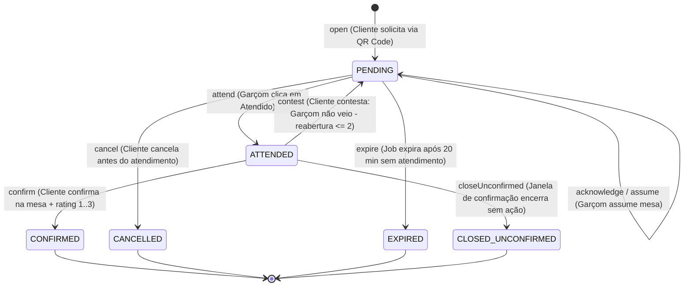

# Regras de Negócio e Máquinas de Estado — TapMesa Backend

Este documento descreve detalhadamente a lógica de negócio, os ciclos de vida, as regras temporais, o cálculo do dia operacional e os algoritmos de consolidação analítica do TapMesa.

---

## 1. Máquina de Estados do Chamado (`ServiceCall`)

O ciclo de vida de um chamado de mesa é modelado como uma máquina de estados finitos estrita com transições controladas e eventos de domínio correspondentes.



### 1.1. Tabela de Transições de Estado

| Estado Inicial    | Ação / Evento            | Estado Final         | Condições e Restrições                                                                                                                                                                             | Ator Responsável   |
| :---------------- | :----------------------- | :------------------- | :------------------------------------------------------------------------------------------------------------------------------------------------------------------------------------------------- | :----------------- |
| **(Inexistente)** | `open`                   | `PENDING`            | Mesa não pode estar pausada. Se já existir chamado pendente do mesmo tipo, retorna o existente (idempotência).                                                                                     | Cliente            |
| `PENDING`         | `acknowledge` / `assume` | `PENDING`            | Permanece em `PENDING`. Grava `acknowledgedAt`, `acknowledgedById` e calcula `reactionTimeSec`. Idempotente se já reconhecido.                                                                     | Garçom / Equipe    |
| `PENDING`         | `cancel`                 | `CANCELLED`          | Só pode ser cancelado enquanto estiver em `PENDING`. Grava `cancelledAt` e `closedAt`.                                                                                                             | Cliente            |
| `PENDING`         | `expire`                 | `EXPIRED`            | Executado após decorridos 20 minutos (1.200 segundos) da abertura sem atendimento. Grava `expiredAt` e `closedAt`.                                                                                 | Sistema (Job Cron) |
| `PENDING`         | `attend`                 | `ATTENDED`           | Garçom finaliza o atendimento. Grava `attendedAt`, `attendedById` e calcula `executionTimeSec`. Abre a janela de confirmação. Idempotente.                                                         | Garçom             |
| `ATTENDED`        | `confirm`                | `CONFIRMED`          | Cliente confirma que foi atendido. Pode enviar `rating` (1, 2 ou 3). Grava `confirmedAt` e `closedAt`. Idempotente se já confirmado.                                                               | Cliente            |
| `ATTENDED`        | `contest`                | `PENDING`            | Cliente contesta o atendimento ("Garçom não veio"). Se `reopenCount < 2`, volta para `PENDING` e incrementa `reopenCount`. Se `reopenCount >= 2`, marca `contested = true` e permanece `ATTENDED`. | Cliente            |
| `ATTENDED`        | `closeUnconfirmed`       | `CLOSED_UNCONFIRMED` | Executado automaticamente após decorrida a janela de tolerância (`confirmationWindowSec`, padrão 180s) sem ação do cliente. Grava `closedAt`.                                                      | Sistema (Job Cron) |

---

## 2. Regra de Avaliação Rápida (Rating - T26)

Para medir a satisfação do cliente com fricção mínima, a confirmação do atendimento suporta uma avaliação rápida de 3 pontos:

- **Escala Permitida:**
  - `1`: Ruim 🙁
  - `2`: Regular 😐
  - `3`: Bom / Excelente 😊
- **Validação Estrita:** Se o frontend enviar qualquer valor fora do conjunto `{1, 2, 3}` (ex: 0, 4, 5 ou casas decimais), o backend rejeita com erro `400 Bad Request` (`INVALID_RATING`: _"A avaliação deve ser um número inteiro entre 1 e 3"_).
- **Armazenamento e Métricas:** O valor é gravado em `service_calls.rating`. É consolidado na média de satisfação do garçom (`/restaurant/users/metrics`) e no Resumo do Dia (`/analytics/summary`).

---

## 3. Conceito de Dia Operacional (`Operational Day`)

Restaurantes, bares e casas noturnas frequentemente operam além da meia-noite (madrugada adentro). Se os atendimentos das 02:00 da manhã de sábado fossem atribuídos ao dia de sábado, as métricas do turno de sexta-feira ficariam fragmentadas.

### 3.1. Hora de Corte (`dayCutoffHour`)

- Cada restaurante define seu fuso horário (ex: `America/Sao_Paulo`) e a hora de virada do dia (`dayCutoffHour`, padrão `5` = 05:00 da manhã).
- **Regra:** Qualquer atendimento ocorrido entre as 00:00 e as 04:59 de um dia civil pertence **ao dia operacional anterior**.

```
Exemplo com dayCutoffHour = 5 (Fuso America/Sao_Paulo):
- Chamado criado em 21/10/2026 às 23:45 -> Dia Operacional: 2026-10-21
- Chamado criado em 22/10/2026 às 02:30 -> Dia Operacional: 2026-10-21 (ainda é o turno de 21/10)
- Chamado criado em 22/10/2026 às 05:01 -> Dia Operacional: 2026-10-22 (novo dia operacional iniciado)
```

O cálculo é executado deterministicamente pela classe de domínio [`OperationalDayCalculator`](../../src/modules/analytics/domain/OperationalDayCalculator.ts).

---

## 4. Métricas de Tempo e Níveis de Alerta no Painel

### 4.1. Cálculos de Tempo

- **Tempo de Espera Decorrido (`elapsedSec`):**
  $$\text{elapsedSec} = \text{serverNow} - \text{createdAt}$$
  _(Em segundos)._
- **Tempo de Reação (`reactionTimeSec`):**
  $$\text{reactionTimeSec} = (\text{acknowledgedAt} \lor \text{attendedAt}) - \text{createdAt}$$
  Tempo decorrido até a equipe reconhecer/assumir o chamado.
- **Tempo de Execução / Atendimento (`executionTimeSec`):**
  $$\text{executionTimeSec} = \text{attendedAt} - \text{createdAt}$$
  Tempo total desde a abertura do chamado até o garçom chegar à mesa e marcar como atendido.

### 4.2. Níveis de Alerta e Cores no Painel

O painel classifica os chamados pendentes em três estados visuais baseados nas configurações do restaurante:

| Nível de Alerta        | Condição de Tempo                                                          | Sinalização Visual no Frontend           |
| :--------------------- | :------------------------------------------------------------------------- | :--------------------------------------- |
| **Normal**             | $\text{elapsedSec} < \text{alertSec}$ (ex: até 3 min)                      | Card em tom padrão (Verde ou Neutro)     |
| **Alerta / Warning**   | $\text{alertSec} \le \text{elapsedSec} < \text{urgentSec}$ (ex: 3 a 5 min) | Card Amarelo / Laranja pulsante          |
| **Urgente / Critical** | $\text{elapsedSec} \ge \text{urgentSec}$ (ex: acima de 5 min)              | Card Vermelho piscante com alarme sonoro |

---

## 5. Jobs Agendados em Segundo Plano (`Scheduled Jobs`)

A aplicação executa 6 tarefas periódicas. Todas disparam a cada `JOBS_SCHEDULE_INTERVAL_SEC` (padrão **30 s**; desligáveis com `JOBS_ENABLED=false`) e usam um advisory lock do PostgreSQL para que só uma instância execute cada job por vez. A frequência efetiva de cada regra é controlada dentro do job:

1. **`ExpirePendingCallsJob`:**
   - Varre o banco em busca de chamados com `status = 'PENDING'` cujo tempo decorrido excedeu 20 minutos (1.200s).
   - Transiciona para `EXPIRED`, emite o evento `call.expired` via SSE e grava o evento de domínio.
2. **`CloseUnconfirmedCallsJob`:**
   - Localiza chamados em `ATTENDED` cujo tempo decorrido desde `attendedAt` ultrapassou o `confirmationWindowSec` do restaurante.
   - Transiciona para `CLOSED_UNCONFIRMED`, emite `call.closed` e encerra o ciclo.
3. **`RollupDailyJob`:**
   - A cada execução recalcula (upsert idempotente) o consolidado do dia operacional em curso e do anterior: totais, tempos médio/mediana/p90/máximo, distribuição por hora e ranking de mesas, gravados em `daily_summaries`.
4. **`DailySummaryEmailJob`:**
   - Na primeira hora após o fechamento do dia operacional (`dayCutoffHour` no fuso do restaurante), envia uma única vez o resumo do dia que fechou para os restaurantes com `emailSummaryEnabled: true`.
   - Limitação: o controle de "já enviado" fica em memória; se a API reiniciar dentro dessa hora, o resumo pode ser reenviado uma vez.
5. **`UrgentAlertJob`:**
   - Identifica chamados pendentes que ultrapassaram o `urgentSec` do restaurante e envia um alerta por restaurante, respeitando o `alertCooldownMinutes` (padrão 15 min).
   - A segunda regra do RF-R12 (tempo médio da última hora acima da meta) ainda não está implementada.
6. **`CleanupJob`:**
   - Remove refresh tokens expirados e tickets de SSE vencidos.

> **E-mail:** o adaptador atual é `InMemoryEmailSender` (guarda as últimas 100 mensagens em memória). Nenhum e-mail sai do servidor até existir um adaptador SMTP/provedor real.

---

## 6. Motor de Consolidação Analítica (Rollup)

Para viabilizar consultas instantâneas no dashboard do gestor sem sobrecarregar a tabela transacional de chamados:

- **Dias Anteriores:** As métricas de dias passados são lidas diretamente da tabela `daily_summaries` (leitura em $O(1)$ de JSON pré-calculado).
- **Dia Atual (Hoje):** O endpoint `/analytics/summary` calcula as métricas em tempo real sobre os chamados do dia operacional em curso e, caso o filtro abranja múltiplos dias (ex: últimos 30 dias), faz o _merge_ ponderado matematicamente preciso entre os rollups arquivados e os dados ao vivo do dia atual.
