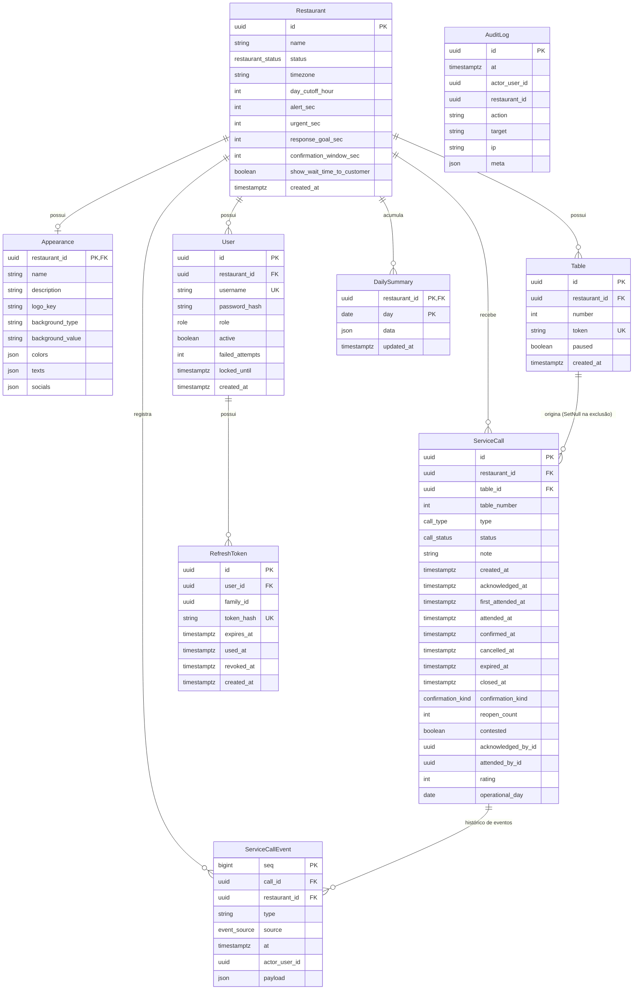

# Modelo de Dados e Esquema de Banco — TapMesa Backend

Este documento apresenta o modelo relacional completo do TapMesa, o schema do Prisma ORM, enums, relacionamentos, integridade referencial, restrições e o mapeamento entre entidades internas e DTOs de apresentação.

---

## 1. Diagrama Entidade-Relacionamento (ERD)



---

## 2. Enums do Sistema

Os enums são tipados e mapeados para tipos nativos do PostgreSQL via `@map`:

| Enum               | Valores                                                                          | Descrição                                              |
| :----------------- | :------------------------------------------------------------------------------- | :----------------------------------------------------- |
| `Role`             | `ADMIN`, `OWNER`, `WAITER`                                                       | Perfis de acesso dos usuários.                         |
| `RestaurantStatus` | `ACTIVE`, `SUSPENDED`                                                            | Situação operacional do restaurante.                   |
| `CallType`         | `WAITER`, `BILL`                                                                 | Tipo de chamado: Chamar Garçom ou Pedir Conta.         |
| `CallStatus`       | `PENDING`, `ATTENDED`, `CONFIRMED`, `CLOSED_UNCONFIRMED`, `CANCELLED`, `EXPIRED` | Estados do ciclo de vida de um atendimento.            |
| `ConfirmationKind` | `CUSTOMER`                                                                       | Tipo de confirmação (confirmado pelo cliente na mesa). |
| `EventSource`      | `CUSTOMER`, `STAFF`, `SYSTEM`                                                    | Origem do evento no log imutável de chamados.          |

---

## 3. Tabelas e Campos Detalhados

### 3.1. `restaurants`

Armazena os estabelecimentos cadastrados e suas regras operacionais.

- `id` (`UUID`, PK): Identificador universal do restaurante.
- `name` (`VARCHAR`): Nome fantasia do estabelecimento.
- `status` (`restaurant_status`, Default: `'ACTIVE'`): `ACTIVE` ou `SUSPENDED`.
- `timezone` (`VARCHAR`, Default: `'America/Sao_Paulo'`): Fuso horário IANA para cálculo do dia operacional e agendamentos.
- `day_cutoff_hour` (`INT`, Default: `5`): Hora de virada do dia operacional (ex: 5h da manhã).
- `alert_sec` (`INT`, Default: `180`): Tempo em segundos para sinalização de alerta de espera (_Warning_ / Laranja).
- `urgent_sec` (`INT`, Default: `300`): Tempo em segundos para sinalização de urgência (_Critical_ / Vermelho).
- `response_goal_sec` (`INT`, Default: `180`): Meta de SLA para cálculo de taxa de sucesso nas métricas.
- `confirmation_window_sec` (`INT`, Default: `180`): Janela de tolerância (em segundos) concedida ao cliente para confirmar ou contestar o atendimento antes do encerramento automático.
- `show_wait_time_to_customer` (`BOOLEAN`, Default: `false`): Determina se a tela do cliente na mesa exibe o cronômetro com o tempo de espera.
- `created_at` (`TIMESTAMPTZ`): Data e hora de criação.

---

### 3.2. `appearances`

Customização de marca e layout da tela pública das mesas.

- `restaurant_id` (`UUID`, PK, FK): Chave primária e estrangeira vinculada a `restaurants.id` (1:1, `onDelete: Cascade`).
- `name` (`VARCHAR`): Nome público exibido aos clientes.
- `description` (`TEXT`, Opcional): Descrição ou slogan.
- `logo_key` (`VARCHAR`, Opcional): Identificador do arquivo de logotipo no storage.
- `background_type` (`VARCHAR`, Default: `'color'`): `'color'` ou `'image'`.
- `background_value` (`VARCHAR`, Opcional): Código HEX da cor ou URL da imagem de fundo.
- `colors` (`JSONB`, Default: `{}`): Paleta de cores (`primary`, `secondary`, `background`, `text`).
- `texts` (`JSONB`, Default: `{}`): Textos personalizados de boas-vindas e rótulos dos botões.
- `socials` (`JSONB`, Default: `{}`): Redes sociais e credenciais de Wi-Fi para clientes.

---

### 3.3. `users`

Usuários do sistema (Administradores, Proprietários e Garçons).

- `id` (`UUID`, PK): Identificador do usuário.
- `restaurant_id` (`UUID`, FK, Opcional): Chave estrangeira para `restaurants.id` (`onDelete: Cascade`). Nulo para `ADMIN`.
- `username` (`VARCHAR`, Unique): Nome de usuário único globalmente.
- `password_hash` (`VARCHAR`): Hash Argon2id da senha.
- `role` (`role`): Perfil de acesso (`ADMIN`, `OWNER`, `WAITER`).
- `active` (`BOOLEAN`, Default: `true`): Flag de ativação.
- `failed_attempts` (`INT`, Default: `0`): Contador de falhas consecutivas de login.
- `locked_until` (`TIMESTAMPTZ`, Opcional): Data/hora até a qual o usuário está temporariamente bloqueado.
- `created_at` (`TIMESTAMPTZ`).

---

### 3.4. `refresh_tokens`

Sessões ativas e histórico rotativo de tokens de refresh.

- `id` (`UUID`, PK): Identificador do registro.
- `user_id` (`UUID`, FK): Referência a `users.id` (`onDelete: Cascade`).
- `family_id` (`UUID`): Identificador único da família da sessão de login.
- `token_hash` (`VARCHAR`, Unique): Hash SHA-256 do token rotativo emitido.
- `expires_at` (`TIMESTAMPTZ`): Data de expiração (30 dias).
- `used_at` (`TIMESTAMPTZ`, Opcional): Preenchido quando o token é rotacionado.
- `revoked_at` (`TIMESTAMPTZ`, Opcional): Preenchido se a sessão foi explicitamente encerrada ou invalidada por detecção de reúso.
- `created_at` (`TIMESTAMPTZ`).

---

### 3.5. `tables`

Mesas físicas do salão do restaurante.

- `id` (`UUID`, PK): Identificador da mesa.
- `restaurant_id` (`UUID`, FK): Restaurante proprietário (`onDelete: Cascade`).
- `number` (`INT`): Número físico da mesa (ex: 1, 2, 10).
- `token` (`VARCHAR`, Unique): Token público criptográfico seguro HMAC SHA-256 (utilizado no QR Code).
- `paused` (`BOOLEAN`, Default: `false`): Flag de pausa temporária da mesa.
- `created_at` (`TIMESTAMPTZ`).
- **Restrição de Unicidade Composta:** `@@unique([restaurantId, number])` — impede números de mesa duplicados no mesmo restaurante.

---

### 3.6. `service_calls`

Histórico e estado atual de todos os atendimentos solicitados.

- `id` (`UUID`, PK): Identificador único do chamado.
- `restaurant_id` (`UUID`, FK): Referência a `restaurants.id`.
- `table_id` (`UUID`, FK, Opcional, `onDelete: SetNull`): Referência a `tables.id`. **Importante:** Se a mesa for excluída pelo proprietário, o chamado não é apagado; `table_id` torna-se nulo, preservando a integridade das métricas do restaurante.
- `table_number` (`INT`): Cópia denormalizada do número da mesa para leitura rápida e preservação histórica.
- `type` (`call_type`): `WAITER` (Chamar Garçom) ou `BILL` (Pedir a Conta).
- `status` (`call_status`): `PENDING`, `ATTENDED`, `CONFIRMED`, `CLOSED_UNCONFIRMED`, `CANCELLED` ou `EXPIRED`.
- `note` (`TEXT`, Opcional): Observação curta do cliente, sanitizada e limitada a 150 caracteres no domínio (`CallNote`, RF-C04 / RN-09).
- `created_at` (`TIMESTAMPTZ`): Momento da abertura do chamado pelo cliente.
- `acknowledged_at` (`TIMESTAMPTZ`, Opcional): Momento em que o garçom clicou em "Estou a caminho" ou "Assumir".
- `acknowledged_by_id` (`UUID`, Opcional): Atendente que reconheceu/assumiu o chamado.
- `first_attended_at` (`TIMESTAMPTZ`, Opcional): Momento do primeiro atendimento (preservado em caso de reabertura).
- `attended_at` (`TIMESTAMPTZ`, Opcional): Momento em que o garçom marcou como atendido.
- `attended_by_id` (`UUID`, Opcional): Atendente que finalizou o atendimento.
- `confirmed_at` (`TIMESTAMPTZ`, Opcional): Momento em que o cliente confirmou o atendimento.
- `closed_at` (`TIMESTAMPTZ`, Opcional): Momento de término definitivo do chamado.
- `cancelled_at` (`TIMESTAMPTZ`, Opcional): Preenchido se cancelado pelo cliente.
- `expired_at` (`TIMESTAMPTZ`, Opcional): Preenchido se expirado automaticamente após 20 minutos sem atendimento.
- `confirmation_kind` (`confirmation_kind`, Opcional): Default `CUSTOMER`.
- `reopen_count` (`INT`, Default: `0`): Quantidade de contestações/reaberturas realizadas pelo cliente (máximo 2).
- `contested` (`BOOLEAN`, Default: `false`): Marcado como `true` se o cliente contestou o atendimento após atingir o limite de reaberturas.
- `rating` (`INT`, Opcional): Avaliação rápida de 1 a 3 (1=Ruim, 2=Regular, 3=Bom).
- `operational_day` (`DATE`): Data operacional à qual este atendimento pertence (indexada para consolidação e rollup).

---

### 3.7. `service_call_events`

Log imutável de eventos de auditoria e transições de chamados (Event Sourcing parcial).

- `seq` (`BIGINT`, PK, Autoincrement): Sequência ordenada globalmente.
- `call_id` (`UUID`, FK): Referência a `service_calls.id` (`onDelete: Cascade`).
- `restaurant_id` (`UUID`, FK): Referência a `restaurants.id`.
- `type` (`VARCHAR`): Tipo do evento (ex: `CALL_OPENED`, `CALL_ACKNOWLEDGED`, `CALL_ATTENDED`, `CALL_CONFIRMED`, `CALL_REOPENED`, `CALL_CANCELLED`, `CALL_EXPIRED`, `CALL_CLOSED`).
- `source` (`event_source`): `CUSTOMER`, `STAFF` ou `SYSTEM`.
- `at` (`TIMESTAMPTZ`): Timestamp exato do evento.
- `actor_user_id` (`UUID`, Opcional): ID do garçom ou usuário que provocou o evento.
- `payload` (`JSONB`, Opcional): Metadados complementares.

---

### 3.8. `daily_summaries`

Tabela de rollups diários pré-calculados.

- `restaurant_id` (`UUID`, PK, FK): Referência a `restaurants.id`.
- `day` (`DATE`, PK): Dia operacional consolidado.
- `data` (`JSONB`): Métricas e rankings consolidados em JSON (totais, SLA, percentis de tempo p50/p90/p95, distribuição por hora e ranking de mesas).
- `updated_at` (`TIMESTAMPTZ`).
- **Chave Primária Composta:** `@@id([restaurantId, day])`.

---

### 3.9. `audit_logs`

Trilha de auditoria administrativa e de segurança do sistema.

- `id` (`UUID`, PK): Identificador do log.
- `at` (`TIMESTAMPTZ`, Default: `now()`): Data/hora da ação.
- `actor_user_id` (`UUID`, Opcional): Usuário responsável pela ação.
- `restaurant_id` (`UUID`, Opcional): Restaurante relacionado.
- `action` (`VARCHAR`): Nome da ação (ex: `CREATE_RESTAURANT`, `DELETE_RESTAURANT`, `DELETE_TABLE`, `UPDATE_SETTINGS`, `IMPERSONATED_ACTION`).
- `target` (`VARCHAR`, Opcional): Recurso alvo da alteração.
- `ip` (`VARCHAR`, Opcional): Endereço IP do cliente.
- `meta` (`JSONB`, Opcional): Detalhes contextuais.
- **Nota Arquitetural:** `AuditLog` **não possui Foreign Keys propositalmente**. Os registros de auditoria devem sobreviver permanentemente mesmo após a exclusão de usuários ou restaurantes.

---

## 4. Índices Parciais e Otimizações de Banco de Dados

### 4.1. Índice Parcial `uq_pending_call`

O PostgreSQL implementa um índice de unicidade parcial fundamental para a regra de idempotência do TapMesa:

```sql
CREATE UNIQUE INDEX "uq_pending_call"
ON "service_calls"("restaurant_id", "table_id", "type")
WHERE "status" = 'PENDING';
```

- **Efeito:** Impede no nível físico do banco que uma mesa tenha mais de um chamado `PENDING` simultâneo do mesmo tipo (`WAITER` ou `BILL`).
- **Garantia:** Mesmo sob condições de alta concorrência (_race conditions_ de múltiplos cliques rápidos no celular), nenhuma mesa conseguirá abrir chamados duplicados.

### 4.2. Índices de Desempenho

- `service_calls(restaurant_id, operational_day)`: Otimiza as consultas analíticas e rollups diários.
- `service_calls(restaurant_id, status)`: Otimiza o carregamento do painel em tempo real da equipe.
- `refresh_tokens(family_id)`: Otimiza a revogação instantânea de famílias de sessão.
- `audit_logs(restaurant_id, at)` e `audit_logs(at)`: Otimizam a consulta paginada de auditoria.

---

## 5. Mapeamento de Domínio vs DTOs de Apresentação

Para garantir segurança e separação de responsabilidades (Clean Architecture), o backend nunca expõe diretamente as entidades do Prisma ou do Domínio.

| Entidade Interna | DTO Exposto à API          | Regras de Transformação e Redação                                                                                                                                 |
| :--------------- | :------------------------- | :---------------------------------------------------------------------------------------------------------------------------------------------------------------- |
| `User`           | `AuthUser` / `TeamUserDto` | Campos sensíveis `passwordHash`, `failedAttempts` e `lockedUntil` são **completamente removidos**.                                                                |
| `RefreshToken`   | _Nenhum DTO_               | `tokenHash` e `familyId` nunca são expostos. Apenas o valor bruto aleatório trafega no cookie `HttpOnly`.                                                         |
| `Table`          | `TableDto`                 | `token` HMAC é exibido apenas ao `OWNER`/`ADMIN` para gerar links e QR Codes.                                                                                     |
| `Table`          | `PublicTableDto`           | O token **não é devolvido** na resposta pública (já é de conhecimento do cliente que acessou via URL). Apenas status de disponibilidade e aparência são expostos. |
| `ServiceCall`    | `PanelCallDto`             | Inclui tempos calculados em segundos (`reactionTimeSec`, `executionTimeSec`), dados do atendente e header `X-Server-Now`.                                         |
| `ServiceCall`    | `PublicCallDto`            | Remove IDs de usuários internos e informações confidenciais do painel. Informa apenas status, tempo de criação e confirmação.                                     |
