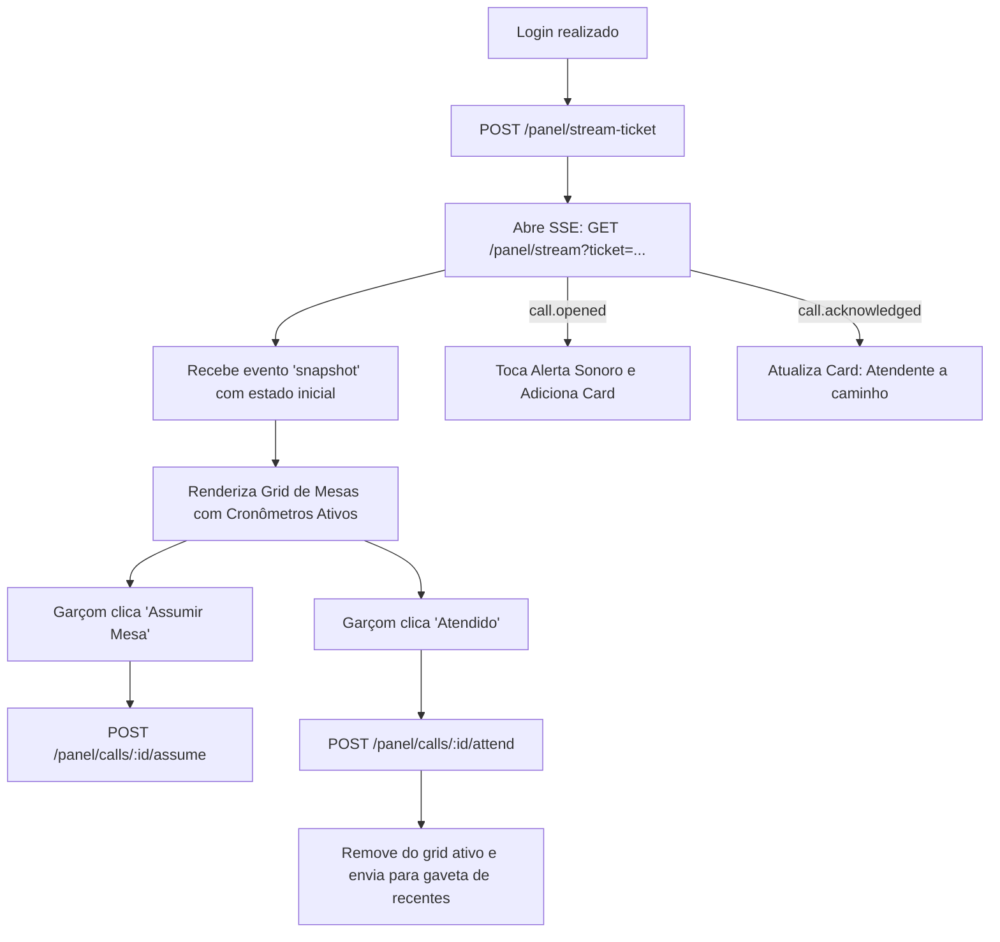

# Mapeamento de Telas do Frontend para Endpoints da API — TapMesa

Este documento serve como mapa de navegação direto para a equipe de frontend, correlacionando cada tela da aplicação com seus respectivos endpoints REST, eventos SSE, pré-condições e fluxos de estado.

---

## 1. Tela Pública do Cliente (Mobile Web via QR Code)

- **Rota no Frontend:** `/m/:token`
- **Público:** Clientes no salão do bar/restaurante via smartphone.
- **Autenticação:** Nenhuma (Pública). Acesso validado pelo `:token` contido na URL.

```mermaid
flowchart TD
    Scan([Cliente lê QR Code]) --> Load[GET /public/tables/:token]
    Load --> Check{Disponível?}
    Check -- Não --> Paused[Exibe Tela de Mesa Indisponível / Pausada]
    Check -- Sim --> Render[Renderiza Tela com Tema e Cores da Casa]
    Render --> SSE[Abre GET /public/tables/:token/stream]

    Render --> CallAction[Cliente clica Chamar Garçom ou Pedir Conta]
    CallAction --> PostCall[POST /public/tables/:token/calls]
    PostCall --> PendingState[Estado PENDING: Exibe Card de Chamado em Aberto]

    SSE -->|call.attended| AttendedState[Estado ATTENDED: Garçom esteve na mesa]
    AttendedState --> ConfirmAction[Cliente clica Confirmar Atendimento]
    ConfirmAction --> PostConfirm[POST /public/tables/:token/calls/:callId/confirm { rating: 1..3 }]

    AttendedState --> ContestAction[Cliente clica 'Garçom não veio']
    ContestAction --> PostContest[POST /public/tables/:token/calls/:callId/contest]
    PostContest --> PendingState
```

### 1.1. Endpoints Utilizados na Tela da Mesa

| Ação na Interface                           | Método & Endpoint                                         | Payload / Parâmetros                            | Resposta Esperada                                                        | Tratamento de Erro                                                                                                        |
| :------------------------------------------ | :-------------------------------------------------------- | :---------------------------------------------- | :----------------------------------------------------------------------- | :------------------------------------------------------------------------------------------------------------------------ |
| **Carregamento inicial da página**          | `GET /api/v1/public/tables/:token`                        | Parâmetro `:token` na rota                      | `PublicTableDto` (nome, cores, logo, número da mesa e chamados em curso) | Se `404`, exibir tela de "Mesa não encontrada / QR Code inválido". Se `available: false`, exibir motivo (`TABLE_PAUSED`). |
| **Conexão SSE em tempo real**               | `GET /api/v1/public/tables/:token/stream`                 | Stream contínuo                                 | Eventos Server-Sent Events                                               | Reconexão automática com backoff exponencial se cair.                                                                     |
| **Chamar Garçom**                           | `POST /api/v1/public/tables/:token/calls`                 | `{ "type": "WAITER", "note": "... (até 150)" }` | `201 Created` ou `200 OK` (`alreadyPending: true`)                       | Se `400` com `TABLE_PAUSED`, notificar bloqueio temporário.                                                               |
| **Pedir a Conta**                           | `POST /api/v1/public/tables/:token/calls`                 | `{ "type": "BILL", "note": "..." }`             | `201 Created` ou `200 OK`                                                | Mesma idempotência de chamada.                                                                                            |
| **Cancelar Chamado**                        | `POST /api/v1/public/tables/:token/calls/:callId/cancel`  | `:token` e `:callId` na rota                    | `200 OK`                                                                 | Se `400`, chamado já foi atendido.                                                                                        |
| **Confirmar Atendimento + Avaliação (T26)** | `POST /api/v1/public/tables/:token/calls/:callId/confirm` | `{ "rating": 1 \| 2 \| 3 }`                     | `200 OK`                                                                 | Avaliação de 1 (Ruim) a 3 (Bom).                                                                                          |
| **Contestar Atendimento**                   | `POST /api/v1/public/tables/:token/calls/:callId/contest` | `:token` e `:callId` na rota                    | `200 OK`                                                                 | Reverte status para PENDING.                                                                                              |

---

## 2. Painel Operacional em Tempo Real (Garçons / Staff)

- **Rota no Frontend:** `/panel`
- **Público:** Garçons, maitres e equipe de salão/cozinha (Tablets, Celulares ou Monitores).
- **Perfis Permitidos:** `WAITER`, `OWNER`, `ADMIN`.



### 2.1. Endpoints Utilizados no Painel

| Ação no Painel                      | Método & Endpoint                          | Observações de Implementação                                                 |
| :---------------------------------- | :----------------------------------------- | :--------------------------------------------------------------------------- |
| **Obter Ticket SSE**                | `POST /api/v1/panel/stream-ticket`         | Chamar antes de instanciar `new EventSource`. Ticket válido por 60s.         |
| **Conexão SSE**                     | `GET /api/v1/panel/stream?ticket=<ticket>` | Recebe evento `snapshot` imediatamente com lista inicial e tempos de alerta. |
| **Fallback REST de Estado**         | `GET /api/v1/panel/state`                  | Utilizado caso a conexão SSE não possa ser estabelecida.                     |
| **Assumir Chamado (T26)**           | `POST /api/v1/panel/calls/:id/assume`      | Garçom assume a responsabilidade. Registra tempo de reação.                  |
| **Marcar como Atendido**            | `POST /api/v1/panel/calls/:id/attend`      | Transiciona para `ATTENDED`. Inicia a janela de tolerância de confirmação.   |
| **Gaveta de Atendimentos Recentes** | `GET /api/v1/panel/calls/recent?limit=15`  | Últimos atendidos (máx. 50) com `confirmationStatus`.                        |

---

## 3. Gestão de Mesas e Impressão de QR Codes

- **Rota no Frontend:** `/dashboard/tables`
- **Perfis Permitidos:** `OWNER`, `ADMIN`.

| Ação na Interface                    | Método & Endpoint                      | Descrição e Contrato                                                                |
| :----------------------------------- | :------------------------------------- | :---------------------------------------------------------------------------------- |
| **Listagem de Mesas**                | `GET /api/v1/tables`                   | Mesas com pausa, token e `url` (link canônico do QR: use-o no "Copiar link").       |
| **Sugestão de Próximo Número**       | `GET /api/v1/tables/next-number`       | Preenche automaticamente o campo no modal de "Nova Mesa".                           |
| **Cadastrar Mesas em Lote**          | `POST /api/v1/tables`                  | Body: `{ "startNumber": 1, "count": 10 }`. Tratar `409` com lista de `duplicates`.  |
| **Pausar Mesa**                      | `PATCH /api/v1/tables/:id/pause`       | Mesa para de aceitar novos chamados.                                                |
| **Reativar Mesa**                    | `PATCH /api/v1/tables/:id/resume`      | Mesa volta a aceitar chamados normalmente.                                          |
| **Excluir Mesa**                     | `DELETE /api/v1/tables/:id`            | Modal de confirmação: encerra streams da mesa no cliente.                           |
| **Visualização / Impressão em Lote** | `GET /api/v1/tables/print`             | `{ restaurant: { name, logoUrl }, tables: [{ ..., url, qrSvg }] }` para a folha A4. |
| **Download individual de QR**        | `GET /api/v1/tables/:id/qr?format=svg` | PNG (padrão) ou SVG; cabeçalho `X-Table-Url` com o link embutido.                   |

---

## 4. Resumo do Dia e Métricas Analíticas

- **Rota no Frontend:** `/dashboard/analytics`
- **Perfis Permitidos:** `OWNER`, `ADMIN`.

| Componente na Tela                 | Endpoint Utilizado                                     | Dados Exibidos                                                                                                                 |
| :--------------------------------- | :----------------------------------------------------- | :----------------------------------------------------------------------------------------------------------------------------- |
| **Cards de Visão Geral (KPIs)**    | `GET /api/v1/analytics/summary?from=...&to=...`        | Total de chamados, % dentro da meta SLA, tempo médio de espera, satisfação média.                                              |
| **Gráfico de Picos por Hora**      | `GET /api/v1/analytics/by-hour?from=...&to=...`        | `byHour[]` (0h às 23h): volume por tipo e `averageResponseTimeSec`.                                                            |
| **Ranking de Mesas**               | `GET /api/v1/analytics/tables-ranking?from=...&to=...` | `ranking.all                                                                                                                   | waiter | bill`, cada um com `byVolume`e`byResponseTime`. |
| **Tabela Paginada de Chamados**    | `GET /api/v1/analytics/calls?cursor=...&limit=20`      | Filtros `type`, `status`, `table`; há mais páginas enquanto `nextCursor !== null`.                                             |
| **Card de Comparativo Diário**     | `GET /api/v1/analytics/summary/compare`                | `today`, `yesterday`, `sameDayLastWeek` com métricas completas e `delta` absoluto; a variação percentual é calculada no front. |
| **Botão "Exportar Relatório CSV"** | `GET /api/v1/analytics/export.csv?from=...&to=...`     | Download direto do arquivo CSV formatado.                                                                                      |

---

## 5. Gestão de Equipe (Team Users)

- **Rota no Frontend:** `/dashboard/team`
- **Perfis Permitidos:** `OWNER`, `ADMIN`.

| Funcionalidade                  | Endpoint Utilizado                                 | Observações                                                               |
| :------------------------------ | :------------------------------------------------- | :------------------------------------------------------------------------ |
| **Listar Equipe**               | `GET /api/v1/restaurant/users`                     | Lista de membros com status ativo/inativo.                                |
| **Novo Membro**                 | `POST /api/v1/restaurant/users`                    | Body: `{ username, role, password? }`. Exibir senha temporária em modal.  |
| **Ativar / Bloquear Atendente** | `PATCH /api/v1/restaurant/users/:id/status`        | Body: `{ active: boolean }`. Bloqueia o login imediatamente.              |
| **Resetar Senha de Garçom**     | `POST /api/v1/restaurant/users/:id/reset-password` | Exibe nova senha temporária gerada pelo servidor.                         |
| **Remover da Equipe**           | `DELETE /api/v1/restaurant/users/:id`              | Exclusão do usuário (não pode excluir a si próprio).                      |
| **Desempenho por Garçom**       | `GET /api/v1/restaurant/users/metrics`             | `waiters[]`: atendidos, tempo médio, mais rápido e mais lento por garçom. |

---

## 6. Configurações, Marca e Notificações

- **Rota no Frontend:** `/dashboard/settings`
- **Perfis Permitidos:** `OWNER`, `ADMIN`.

| Aba de Configuração          | Endpoints Utilizados                                                                                                                    | Finalidade                                                                                                        |
| :--------------------------- | :-------------------------------------------------------------------------------------------------------------------------------------- | :---------------------------------------------------------------------------------------------------------------- |
| **Atendimento e SLA**        | `GET` e `PUT /api/v1/settings/service`                                                                                                  | Metas de resposta, tempo de alerta, tempo urgente e hora de virada do dia.                                        |
| **Identidade Visual e Logo** | `GET` e `PUT /api/v1/settings/appearance`<br/>`POST /api/v1/settings/appearance/logo`<br/>`POST /api/v1/settings/appearance/background` | Cores, textos (chaves canônicas), links e Wi-Fi (`socials`, substituído inteiro). Upload: JPEG/PNG/WebP até 2 MB. |
| **Restaurar Tema Padrão**    | `POST /api/v1/settings/appearance/reset`                                                                                                | Reseta layout para as cores padrão do TapMesa.                                                                    |
| **E-mails e Alertas**        | `GET` e `PATCH /api/v1/restaurant/notifications/settings`                                                                               | Ativa envio de Resumo Diário e alertas urgentes com cooldown.                                                     |
| **Testar E-mail Diário**     | `POST /api/v1/restaurant/notifications/send-daily-summary`                                                                              | `201 { sent, recipient, subject, operationalDay }`. Ainda não há provedor de e-mail: nada é entregue.             |
| **Testar Alerta Urgente**    | `POST /api/v1/restaurant/notifications/send-urgent-alert`                                                                               | Corpo obrigatório `{ tableNumber, callType, waitDurationSec, urgentThresholdSec, force: true }`. `201`.           |

---

## 7. Portal Administrativo Global (SaaS Admin)

- **Rota no Frontend:** `/admin`
- **Perfil Exclusivo:** `ADMIN`.

| Tela / Modal                   | Endpoint Utilizado                                        | Finalidade                                                                                                                                            |
| :----------------------------- | :-------------------------------------------------------- | :---------------------------------------------------------------------------------------------------------------------------------------------------- |
| **Lista de Restaurantes**      | `GET /api/v1/admin/restaurants?cursor=...`                | Lista em `data` (`id`, `name`, `ownerUsername`, `createdAt`, `status`); `nextCursor` some na última página. Sem contagem de mesas/usuários.           |
| **Cadastrar Restaurante**      | `POST /api/v1/admin/restaurants`                          | Cria restaurante e usuário `OWNER` com senha inicial.                                                                                                 |
| **Suspender Restaurante**      | `PATCH /api/v1/admin/restaurants/:id/suspend`             | Bloqueia logins e encerra chamados do estabelecimento.                                                                                                |
| **Reativar Restaurante**       | `PATCH /api/v1/admin/restaurants/:id/reactivate`          | Restaura a operação do restaurante.                                                                                                                   |
| **Reset de Senha do Owner**    | `POST /api/v1/admin/restaurants/:id/reset-owner-password` | `201 { newPasswordPlain }`: exibir uma única vez.                                                                                                     |
| **Impersonar Restaurante**     | `POST /api/v1/admin/restaurants/:id/impersonate`          | Retorna Access Token para o Admin operar como o restaurante com auditoria.                                                                            |
| **Excluir Restaurante**        | `DELETE /api/v1/admin/restaurants/:id`                    | Body: `{ "confirmName": "Nome Exato" }`. Exclusão em cascata.                                                                                         |
| **Trilha de Auditoria Global** | `GET /api/v1/admin/audit?limit=50`                        | `{ items: [{ at, action, actorUserId, restaurantId, target, ip, meta }], nextCursor, totalCount }`. Filtros: `restaurantId`, `action`, `actorUserId`. |
