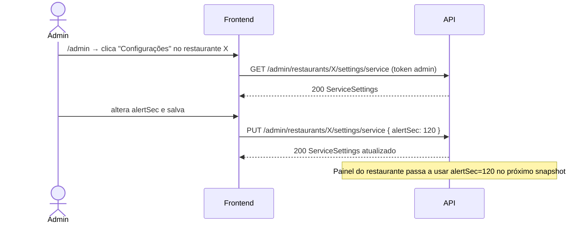

# Migração do Frontend — Configurações do Restaurante Passam a Ser Exclusivas do Admin

> **Para quem é este documento:** um agente de IA (ou dev) que vai alterar o código do **frontend** do TapMesa. Ele é autossuficiente: contém o que mudou, os contratos HTTP completos, as tarefas em ordem e os critérios de aceite. Não é preciso ler o código do backend.
>
> Plano do backend correspondente: `docs/plans/ADMIN_ONLY_SETTINGS_PLAN.md`.

---

## 0. Resumo em 5 linhas

1. A conta do restaurante (`OWNER`) **não pode mais** ver nem alterar configurações (SLA, aparência/logo/fundo, notificações por e-mail).
2. A tela `/dashboard/settings` e o item de menu "Configurações" do dashboard do restaurante **devem ser removidos**.
3. O `ADMIN` passa a configurar cada restaurante numa nova tela do portal: **`/admin/restaurants/:restaurantId/settings`**.
4. Todas as chamadas trocam de prefixo: `/settings/*` e `/restaurant/notifications/*` → `/admin/restaurants/:restaurantId/settings/*` e `/admin/restaurants/:restaurantId/notifications/*`. Bodies e respostas **não mudam**.
5. Usar o **token do próprio admin** (o do login). **Não** usar o token de impersonação para configurar — ele é recusado com `403`.

---

## 1. Regras que o agente deve seguir

- **R1.** Não mantenha nenhuma chamada a `/api/v1/settings/...` ou `/api/v1/restaurant/notifications/...` no código ao final da tarefa.
- **R2.** Toda chamada de configuração deve incluir o `restaurantId` no path. Nunca derive o restaurante do token.
- **R3.** As novas chamadas usam o access token da sessão `ADMIN` (sem `rid`). Se o admin estiver em modo impersonação, a tela de configuração deve usar o token admin original (ver §6.3).
- **R4.** Não altere o formato dos formulários nem as validações de campo existentes: os DTOs são os mesmos.
- **R5.** Reaproveite os componentes de formulário já existentes da tela `/dashboard/settings` (mova-os, não reescreva).
- **R6.** Não remova as telas de mesas, equipe, métricas ou painel do owner — elas **não** fazem parte desta mudança.
- **R7.** Siga os padrões do projeto do frontend (cliente HTTP, gerenciador de estado, roteador, biblioteca de UI) — descubra-os antes de codar (§5, passo 1).

---

## 2. O que muda para cada perfil

| Perfil                        | Antes                                          | Depois                                                                                             |
| :---------------------------- | :--------------------------------------------- | :------------------------------------------------------------------------------------------------- |
| `OWNER`                       | Acessava `/dashboard/settings` e alterava tudo | Sem acesso. Menu e rota removidos. Chamadas antigas retornam `404`                                 |
| `OWNER` impersonado por admin | Alterava configurações "como o restaurante"    | Sem acesso (é tratado como `OWNER`)                                                                |
| `WAITER`                      | Sem acesso                                     | Sem acesso (inalterado)                                                                            |
| `ADMIN`                       | Não conseguia configurar sem impersonar        | Configura qualquer restaurante em `/admin/restaurants/:restaurantId/settings`, inclusive suspensos |

O `OWNER` ainda **lê** algumas configurações indiretamente (não mexer nisso):

- `GET /api/v1/restaurant/current` → `responseGoalSec`, `confirmationWindowSec`, `showWaitTimeToCustomer`.
- Snapshot do painel (`GET /api/v1/panel/state` e evento SSE `snapshot`) → `alertSec`, `urgentSec`.

---

## 3. Mapa de endpoints (antigo → novo)

Base URL: `/api/v1`. Header obrigatório em todas: `Authorization: Bearer <accessToken do ADMIN>`.

| #   | Antigo (remover)                                    | Novo                                                                           | Body                                | Resposta (200, salvo indicação)    |
| --- | --------------------------------------------------- | ------------------------------------------------------------------------------ | ----------------------------------- | ---------------------------------- |
| 1   | `GET /settings/service`                             | `GET /admin/restaurants/:restaurantId/settings/service`                        | —                                   | `ServiceSettings`                  |
| 2   | `PUT /settings/service`                             | `PUT /admin/restaurants/:restaurantId/settings/service`                        | `UpdateServiceSettingsRequest`      | `ServiceSettings`                  |
| 3   | `GET /settings/appearance`                          | `GET /admin/restaurants/:restaurantId/settings/appearance`                     | —                                   | `RestaurantAppearance`             |
| 4   | `PUT /settings/appearance`                          | `PUT /admin/restaurants/:restaurantId/settings/appearance`                     | `UpdateAppearanceRequest`           | `RestaurantAppearance`             |
| 5   | `POST /settings/appearance/reset`                   | `POST /admin/restaurants/:restaurantId/settings/appearance/reset`              | —                                   | `RestaurantAppearance`             |
| 6   | `POST /settings/appearance/logo`                    | `POST /admin/restaurants/:restaurantId/settings/appearance/logo`               | `multipart/form-data`, campo `file` | `RestaurantAppearance`             |
| 7   | `POST /settings/appearance/background`              | `POST /admin/restaurants/:restaurantId/settings/appearance/background`         | `multipart/form-data`, campo `file` | `RestaurantAppearance`             |
| 8   | `GET /restaurant/notifications/settings`            | `GET /admin/restaurants/:restaurantId/notifications/settings`                  | —                                   | `NotificationSettings`             |
| 9   | `PATCH` ou `PUT /restaurant/notifications/settings` | `PATCH /admin/restaurants/:restaurantId/notifications/settings` (**só PATCH**) | `UpdateNotificationSettingsRequest` | `NotificationSettings`             |
| 10  | `POST /restaurant/notifications/send-daily-summary` | `POST /admin/restaurants/:restaurantId/notifications/send-daily-summary`       | `SendDailySummaryRequest`           | **201** `SendDailySummaryResponse` |
| 11  | `POST /restaurant/notifications/send-urgent-alert`  | `POST /admin/restaurants/:restaurantId/notifications/send-urgent-alert`        | `SendUrgentAlertRequest`            | **201** `{ sent: true, ... }`      |

`:restaurantId` é o `id` (UUID) retornado por `GET /api/v1/admin/restaurants`.

---

## 4. Contratos TypeScript

Copie para o arquivo de tipos da API do frontend (substitua as versões antigas, se existirem). Atenção: as respostas de `service` e `appearance` **não** contêm `restaurantId` — se os tipos antigos do front tinham esse campo, remova.

```ts
// ---------- SLA / Atendimento ----------
export interface ServiceSettings {
  responseGoalSec: number; // meta de resposta (s). Default 180
  alertSec: number; // card fica amarelo (s). Default 180
  urgentSec: number; // card fica vermelho (s). Default 300
  confirmationWindowSec: number; // janela p/ cliente confirmar (s). Default 180
  timezone: string; // IANA, ex.: "America/Sao_Paulo"
  dayCutoffHour: number; // 0..23, virada do dia operacional. Default 5
  showWaitTimeToCustomer: boolean; // Default false
}

export type UpdateServiceSettingsRequest = Partial<ServiceSettings>;

// ---------- Aparência ----------
export type BackgroundType = 'color' | 'image';

export interface RestaurantAppearance {
  name: string;
  description: string | null;
  logoUrl: string | null;
  backgroundType: BackgroundType;
  backgroundValue: string | null; // cor hex quando 'color'; URL quando 'image'
  colors: {
    primary: string;
    background: string;
    surface: string;
    text: string;
    [key: string]: string;
  };
  texts: {
    welcomeTitle: string;
    callWaiterButton: string;
    requestBillButton: string;
    notePlaceholder: string;
    pendingMessage: string;
    attendedPrompt: string;
    confirmButton: string;
    contestButton: string;
    cancelButton: string;
    [key: string]: string;
  };
  socials: Record<string, string>; // wifiName e wifiPassword são texto puro
  googleReviewUrl: string | null; // link "escrever avaliação" do Google
}

export interface UpdateAppearanceRequest {
  name?: string;
  description?: string | null;
  backgroundType?: BackgroundType;
  backgroundValue?: string | null;
  colors?: Record<string, string>;
  texts?: Record<string, string>;
  socials?: Record<string, string | null | undefined>;
  googleReviewUrl?: string | null; // link do Google ou só o Place ID; outros domínios dão INVALID_APPEARANCE
}

// ---------- Notificações ----------
export interface NotificationSettings {
  restaurantId: string;
  emailSummaryEnabled: boolean;
  summaryEmailRecipient?: string;
  urgentAlertEnabled: boolean;
  urgentAlertRecipient?: string;
  alertCooldownMinutes: number;
  lastAlertSentAt?: string; // ISO 8601
}

export interface UpdateNotificationSettingsRequest {
  emailSummaryEnabled?: boolean;
  summaryEmailRecipient?: string; // e-mail válido
  urgentAlertEnabled?: boolean;
  urgentAlertRecipient?: string; // e-mail válido
  alertCooldownMinutes?: number; // >= 1
}

export interface SendDailySummaryRequest {
  recipientEmail?: string; // se omitido, usa summaryEmailRecipient
  operationalDay?: string; // "YYYY-MM-DD"; default hoje
}

export interface SendDailySummaryResponse {
  sent: boolean;
  recipient: string;
  subject: string;
  operationalDay: string;
}

export interface SendUrgentAlertRequest {
  tableNumber: number; // >= 1
  callType: string; // "WAITER" | "BILL"
  waitDurationSec: number; // >= 0
  urgentThresholdSec: number; // >= 0
  note?: string;
  force?: boolean; // ignora cooldown
}

// ---------- Erro padrão da API (RFC 7807) ----------
export interface ApiProblem {
  type: string;
  title: string;
  status: number;
  detail: string;
  instance: string;
  requestId: string;
  code?: string;
}

// ---------- Item da listagem admin (já existente) ----------
export interface AdminRestaurantListItem {
  id: string;
  name: string;
  ownerUsername: string;
  createdAt: string;
  status: string; // "ACTIVE" | "SUSPENDED"
}
```

---

## 5. Tarefas em ordem

### Passo 1 — Reconhecimento (não codar ainda)

Rode buscas no repositório do frontend e anote os arquivos encontrados:

```bash
grep -rn "settings/service\|settings/appearance\|restaurant/notifications" src
grep -rn "dashboard/settings" src
grep -rn "impersonat" src
grep -rn "admin/restaurants" src
```

Identifique: (a) o módulo/cliente HTTP que monta as URLs; (b) a definição de rotas; (c) o menu/sidebar do dashboard do owner; (d) os componentes de formulário da tela de configurações; (e) onde o token de impersonação é guardado; (f) a tela de lista de restaurantes do admin.

### Passo 2 — Camada de API

Crie (ou adapte) um serviço de API de configurações **admin** parametrizado por `restaurantId`. Exemplo agnóstico (adapte ao cliente HTTP do projeto, ex.: axios/fetch/ky):

```ts
const base = (restaurantId: string) =>
  `/api/v1/admin/restaurants/${encodeURIComponent(restaurantId)}`;

export const adminRestaurantSettingsApi = {
  getService: (id: string) =>
    http.get<ServiceSettings>(`${base(id)}/settings/service`),
  updateService: (id: string, body: UpdateServiceSettingsRequest) =>
    http.put<ServiceSettings>(`${base(id)}/settings/service`, body),

  getAppearance: (id: string) =>
    http.get<RestaurantAppearance>(`${base(id)}/settings/appearance`),
  updateAppearance: (id: string, body: UpdateAppearanceRequest) =>
    http.put<RestaurantAppearance>(`${base(id)}/settings/appearance`, body),
  resetAppearance: (id: string) =>
    http.post<RestaurantAppearance>(`${base(id)}/settings/appearance/reset`),
  uploadLogo: (id: string, file: File) =>
    http.post<RestaurantAppearance>(
      `${base(id)}/settings/appearance/logo`,
      toFormData(file),
    ),
  uploadBackground: (id: string, file: File) =>
    http.post<RestaurantAppearance>(
      `${base(id)}/settings/appearance/background`,
      toFormData(file),
    ),

  getNotifications: (id: string) =>
    http.get<NotificationSettings>(`${base(id)}/notifications/settings`),
  updateNotifications: (id: string, body: UpdateNotificationSettingsRequest) =>
    http.patch<NotificationSettings>(
      `${base(id)}/notifications/settings`,
      body,
    ),
  sendDailySummary: (id: string, body: SendDailySummaryRequest = {}) =>
    http.post<SendDailySummaryResponse>(
      `${base(id)}/notifications/send-daily-summary`,
      body,
    ),
  sendUrgentAlert: (id: string, body: SendUrgentAlertRequest) =>
    http.post(`${base(id)}/notifications/send-urgent-alert`, body),
};

function toFormData(file: File): FormData {
  const fd = new FormData();
  fd.append('file', file); // nome do campo: "file"
  return fd;
}
```

Regras do upload: **não** defina `Content-Type` manualmente (o browser coloca o boundary). Formatos aceitos: PNG, JPG ou WEBP. Limite de **2 MB** — valide tamanho e tipo no cliente antes de enviar e mostre erro amigável.

Apague as funções antigas que chamavam `/settings/*` e `/restaurant/notifications/*`. Se usar cache de queries (React Query, SWR, Pinia etc.), as chaves devem incluir o `restaurantId`, ex.: `['admin', 'restaurants', restaurantId, 'settings', 'service']`.

### Passo 3 — Remover a configuração do dashboard do restaurante

1. Remover a rota `/dashboard/settings` do roteador.
2. Remover o item "Configurações" do menu/sidebar do dashboard do owner.
3. Se alguém acessar `/dashboard/settings` por link salvo, redirecionar para a home do dashboard (ex.: `/dashboard`). Opcional: toast "As configurações do restaurante são gerenciadas pelo suporte TapMesa".
4. Remover a página/container antiga. **Mover** (não apagar) os componentes de formulário reutilizáveis para uma pasta compartilhada ou do admin (ex.: `features/admin/restaurant-settings/`).
5. Remover qualquer atalho para configurações em outras telas do owner (ex.: link "editar aparência" no dashboard, onboarding).

### Passo 4 — Nova tela no portal admin

Rota: **`/admin/restaurants/:restaurantId/settings`** (protegida para `role === 'ADMIN'`, mesma guarda das demais rotas `/admin`).

Layout:

```
┌──────────────────────────────────────────────────────────────┐
│ ← Restaurantes   Configurações — <Nome do restaurante>  [SUSPENSO]? │
├──────────────────────────────────────────────────────────────┤
│ [Atendimento e SLA] [Identidade visual] [E-mails e alertas]  │
├──────────────────────────────────────────────────────────────┤
│  (formulários reaproveitados da antiga /dashboard/settings)   │
└──────────────────────────────────────────────────────────────┘
```

| Aba               | Carregar           | Salvar / ações                                                                                                                                                                                                                    |
| :---------------- | :----------------- | :-------------------------------------------------------------------------------------------------------------------------------------------------------------------------------------------------------------------------------- |
| Atendimento e SLA | `getService`       | `updateService` (enviar só campos alterados é permitido; o backend faz merge)                                                                                                                                                     |
| Identidade visual | `getAppearance`    | `updateAppearance` (inclui o campo "Link de avaliação do Google" — `googleReviewUrl`); botões "Enviar logo" (`uploadLogo`), "Enviar fundo" (`uploadBackground`), "Restaurar padrão" (`resetAppearance`, com modal de confirmação) |
| E-mails e alertas | `getNotifications` | `updateNotifications`; botão "Enviar resumo de teste" (`sendDailySummary`)                                                                                                                                                        |

Detalhes:

- Ler `restaurantId` do parâmetro da rota. Se não for UUID, mostrar "Restaurante inválido" sem chamar a API.
- Nome no cabeçalho: usar o item da listagem se vier no state da navegação; senão usar `name` de `getAppearance`.
- Exibir o badge **SUSPENSO** quando `status === 'SUSPENDED'` (se disponível na listagem). Restaurantes suspensos **podem** ser configurados.
- Após cada salvamento, substituir o estado local pela resposta do servidor (é a fonte da verdade) e mostrar toast de sucesso.
- Após upload, atualizar a pré-visualização com `logoUrl`/`backgroundValue` da resposta.

### Passo 5 — Ponto de entrada na lista de restaurantes do admin

Na tela `/admin` (lista de `GET /api/v1/admin/restaurants`), adicionar em cada linha uma ação **"Configurações"** que navega para `/admin/restaurants/{id}/settings` (passando o item no state da navegação, se o roteador permitir).

### Passo 6 — Impersonação

- O botão "Impersonar" continua existindo para operar mesas, equipe, painel e métricas.
- Durante a impersonação, o dashboard do restaurante **não** mostra configurações (já removidas no passo 3).
- Na barra de aviso de impersonação, adicionar link "Configurar este restaurante" → encerra/suspende a impersonação e navega para `/admin/restaurants/{rid}/settings` usando o **token admin original**. Se o front guarda apenas um token por vez, garanta que o token admin é preservado ao iniciar a impersonação (ex.: `adminAccessToken` separado de `impersonationAccessToken`) — o cliente HTTP da tela admin deve sempre enviar o token admin.

### Passo 7 — Tratamento de erros

Use o campo `code` do corpo (`ApiProblem`) quando existir; senão, o `status`.

| Status | `code`                     | Onde            | UI                                                                                                                                                   |
| :----: | :------------------------- | :-------------- | :--------------------------------------------------------------------------------------------------------------------------------------------------- |
|  400   | —                          | qualquer        | `restaurantId` inválido → "Restaurante inválido"                                                                                                     |
|  400   | `INVALID_SERVICE_SETTINGS` | SLA             | Mostrar `detail` junto ao formulário                                                                                                                 |
|  400   | `INVALID_APPEARANCE`       | Aparência       | Mostrar `detail` junto ao formulário                                                                                                                 |
|  400   | `MISSING_FILE`             | Upload          | "Selecione um arquivo"                                                                                                                               |
|  400   | `INVALID_IMAGE_FORMAT`     | Upload          | "Formato de imagem não suportado (use PNG, JPG ou WEBP)"                                                                                             |
|  400   | `FILE_TOO_LARGE`           | Upload          | "Imagem maior que 2 MB"                                                                                                                              |
|  413   | `PAYLOAD_TOO_LARGE`        | Upload          | "Imagem maior que 2 MB" (arquivos muito grandes são barrados antes)                                                                                  |
|  400   | `SUMMARY_EMAIL_DISABLED`   | Resumo de teste | "Ative o resumo diário e salve antes de testar"                                                                                                      |
|  400   | `URGENT_ALERT_DISABLED`    | Alerta de teste | "Ative os alertas urgentes antes de testar"                                                                                                          |
|  409   | `ALERT_COOLDOWN_ACTIVE`    | Alerta de teste | "Aguarde o cooldown ou envie com 'forçar'"                                                                                                           |
|  401   | —                          | qualquer        | Fluxo de refresh já existente; se falhar, logout                                                                                                     |
|  403   | —                          | qualquer        | "Apenas administradores podem alterar configurações" + voltar para `/admin`. Se ocorrer, verifique se o token de impersonação foi enviado por engano |
|  404   | `RESTAURANT_NOT_FOUND`     | qualquer        | "Restaurante não encontrado" + voltar para a lista                                                                                                   |

### Passo 8 — Limpeza

- Remover tipos, hooks, stores e mocks (MSW, fixtures, Storybook) ligados às rotas antigas.
- Atualizar testes do front: remover testes da tela `/dashboard/settings`; criar testes para a tela admin (§7).
- Rodar o grep do passo 1 novamente: deve retornar zero ocorrências de `settings/service`, `settings/appearance` e `restaurant/notifications` fora do serviço admin novo.

---

## 6. Referência rápida de fluxos

### 6.1. Admin configurando um restaurante



### 6.2. Owner tentando acessar configurações (após a migração)

- Rota `/dashboard/settings` não existe → redireciona para `/dashboard`.
- Se algum código residual chamar `/api/v1/settings/service` → `404`. Isso é bug do front: remover a chamada.

### 6.3. Qual token usar

| Tela                                              | Token                   |
| :------------------------------------------------ | :---------------------- |
| `/admin/**` (inclui a nova tela de configurações) | Token do login do admin |
| `/dashboard/**` durante impersonação              | Token de impersonação   |
| `/dashboard/**` do owner                          | Token do owner          |

---

## 7. Critérios de aceite (testar todos)

- [ ] Logado como `OWNER`: não há item "Configurações" no menu; `/dashboard/settings` redireciona para `/dashboard`.
- [ ] Logado como `OWNER`: nenhuma requisição para `/settings/*` ou `/restaurant/notifications/*` aparece na aba Network em nenhuma tela.
- [ ] Logado como `ADMIN`: lista de restaurantes mostra a ação "Configurações" em cada linha.
- [ ] `ADMIN` abre `/admin/restaurants/:id/settings`, vê o nome do restaurante e as 3 abas carregadas.
- [ ] `ADMIN` salva SLA; ao recarregar a página os valores persistem.
- [ ] `ADMIN` altera cores/textos; a tela pública da mesa (`/m/:token`) do restaurante reflete a mudança.
- [ ] Upload de logo e de fundo funcionam e atualizam a pré-visualização; arquivo > 2 MB mostra erro sem chamar a API.
- [ ] "Restaurar padrão" pede confirmação e restaura.
- [ ] Notificações: salvar e "Enviar resumo de teste" funcionam; erros `SUMMARY_EMAIL_DISABLED` exibem a mensagem correta.
- [ ] Restaurante suspenso pode ser configurado e mostra o badge.
- [ ] Trocar de restaurante X para Y não mostra dados em cache de X (chaves de cache incluem `restaurantId`).
- [ ] Em impersonação, o link "Configurar este restaurante" abre a tela admin e as chamadas usam o token admin (verificar header na aba Network).
- [ ] UUID inválido na URL mostra "Restaurante inválido"; restaurante inexistente mostra "Restaurante não encontrado".
- [ ] Build, lint e testes do front verdes.

---

## 8. Compatibilidade e ordem de deploy

1. Backend Fase 1 em produção: rotas novas disponíveis, antigas ainda funcionando.
2. **Deploy deste frontend.**
3. Backend Fase 2: rotas antigas removidas (`404`).

O frontend migrado **não depende** das rotas antigas, então pode subir assim que a Fase 1 estiver em produção.
